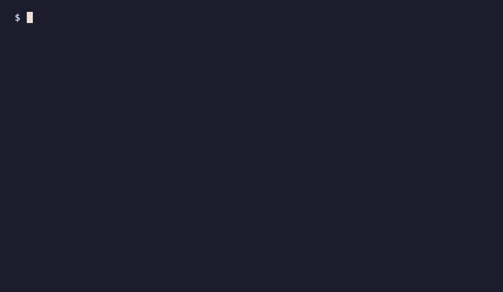
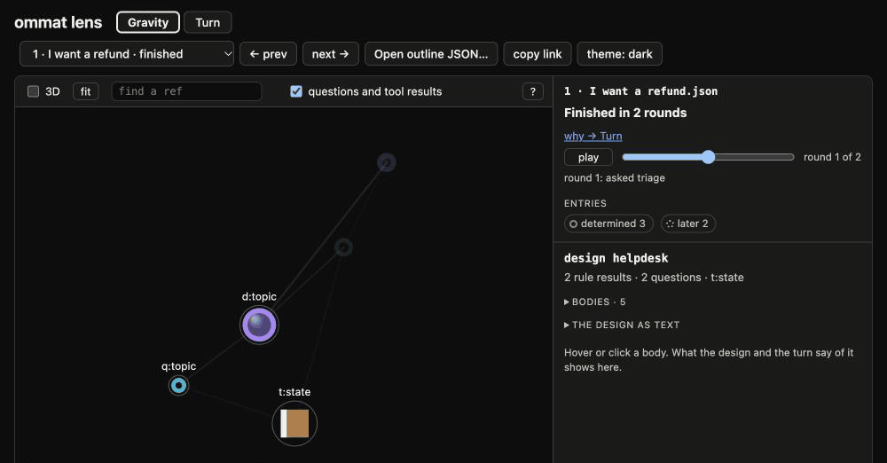

# ommat

ommat is a Python decision engine for workflows that put many small, closed questions to a model. You write each question and each rule separately and declare what it reads. ommat works out the order, skips the questions that earlier answers make unnecessary, and returns a record of the turn that can be replayed without calling the model.



*A nine-question assistant design decides two requests, then replays both. The model's answers are canned so the recording needs no API key; the ordering, the skipped questions, the `Unsure` and the replay are the engine's. [Source](docs/assets/demo).*

## TL;DR

- You write questions and rules, and each declares what it reads. You don't write the order they run in.
- ommat builds the dependency graph from those declarations, runs it in rounds, and sends the questions that are ready at the same time in one call. A question that depends on an earlier answer is asked only when that answer calls for it.
- When an answer isn't confident enough to act on, the result is a marker (`Unsure`, `Unavailable` or `Unasked`) that names its cause, so your code can send it to a person or a larger model. It is never `None`.
- Each turn produces a record. Replaying it reruns the rules against the recorded answers with no model call, which makes debugging and evals cheap.
- The core imports only the standard library. Python 3.11+, MIT.

## Install

```sh
pip install "ommat @ git+https://github.com/CRSiegfried/ommat@v0.5.0"
```

It installs from its git tag until it is on a package index.

## A first decision

This runs as it is, with no API key: a fixed binding answers in place of a model.

The design is a help desk. A source puts questions to a model: a `choice` picks a label and a `noul` is yes or no. A rule reads answers and settles a value. The design asks what a message is about, and asks whether the customer wants money back only when the message is about billing:

<!-- demo -->
```python
from ommat import Design, Question, ReadView, Rule, Source, SourceRequirement, Text
from ommat import Undetermined, decide_sync, escalation, load, replay_sync
from ommat import types as t
from ommat.bindings import fixed
from ommat.helpers import pick_with_margin

TOPICS = ["billing", "shipping", "other"]


def topic(r: ReadView) -> str | Undetermined:
    return pick_with_margin(r, "q:topic", 0.6, 0.2)  # top label at 0.6 or more, 0.2 clear


def route(r: ReadView) -> str | Undetermined:
    topic = r.read("d:topic")
    if topic != "billing":
        return topic  # a queue name, or the marker saying why there is none
    refund = pick_with_margin(r, "q:refund", 0.6, 0.2)
    if isinstance(refund, Undetermined):
        return refund
    return "refunds" if refund == "yes" else "billing"


DESIGN = Design(
    name="helpdesk",
    state=t.record(message=t.string),
    sources={
        "triage": Source(
            {"q:topic": Question("choice", Text("What is the message about?"), TOPICS)},
            needs=["t:state"],
        ),
        "billing": Source(
            {"q:refund": Question("noul", Text("Does the customer want money back?"))},
            needs=["t:state"],
            requirement=SourceRequirement("d:topic", ["billing"]),  # ask only about billing
        ),
    },
    rules={
        "topic": Rule("d:topic", t.label(*TOPICS), topic, version="1", reads=["q:topic"]),
        "route": Rule(
            "d:route",
            t.label("refunds", *TOPICS),
            route,
            version="1",
            reads=["d:topic", "q:refund"],
        ),
    },
)
```

The design doesn't say what runs first. `route` reads `d:topic` and the `billing` source requires it, and ommat orders the turn from those declarations.

Now decide three messages. The stand-in model would answer yes to the refund question for all three, so when `q:refund` goes unasked, that is the engine's decision:

```python
loaded = load(DESIGN)  # checks the whole design before any turn runs

YES = {"yes": 0.9, "no": 0.1}
INBOX = {
    "The invoice is wrong and I want a refund.": {"billing": 0.8, "shipping": 0.1, "other": 0.1},
    "Where is my parcel?": {"billing": 0.05, "shipping": 0.9, "other": 0.05},
    "Hello?": {"billing": 0.4, "shipping": 0.35, "other": 0.25},
}

for message, topics in INBOX.items():
    model = fixed({"q:topic": topics, "q:refund": YES})
    record = decide_sync(loaded, {"message": message}, {"default": model}).record
    asked = [ref for ref, e in record.entries.items() if ref[:2] == "q:" and "value" in e]
    print(message)
    print("  route:", record.entries["d:route"].get("value", "undecided"))
    print("  asked:", ", ".join(asked))
    if why := escalation(record, "d:route"):
        print("  why:", why["kind"], why["root_cause"])
    _, findings = replay_sync(record, loaded)
    print("  replay findings:", findings)
```

It prints:

```text
The invoice is wrong and I want a refund.
  route: refunds
  asked: q:topic, q:refund
  replay findings: []
Where is my parcel?
  route: shipping
  asked: q:topic
  replay findings: []
Hello?
  route: undecided
  asked: q:topic
  why: Unsure {'code': 'abstained', 'refs': ['q:topic']}
  replay findings: []
```
<!-- /demo -->

The parcel message was never asked the refund question: its topic wasn't billing, so `q:refund` holds `Unasked`. For "Hello?" no topic reached the 0.6 bar, so `d:topic` is `Unsure`, `d:route` passes that marker on, and `escalation` traces it back to `q:topic`. Each `replay_sync` reran its turn from the record and found no differences.

In a real project the design lives in its own module, so that it has the same hash from every script that imports it. The tutorial [Write your first design](docs/tutorials/write-a-design.md) starts there.

## Why it exists

Judgement models answer a closed question with probabilities instead of prose, quickly and cheaply enough that I stopped rationing questions. A dozen can be sequenced by hand. A hundred can't, because the answer to one decides whether another is asked at all, and those dependencies end up encoded in the order of the code, where they are hard to see and easy to break.

With ommat each piece declares what it reads and the engine does the sequencing. `load` checks the whole design before any turn runs, and refuses one where a read has no provider, something depends on itself, or the types disagree.

A rule can also be a decision table as DMN 1.5 defines one, and the declared reads are DMN's information requirements. ommat adds what DMN leaves out and this job needs: markers with causes where DMN has one `null`, rounds where DMN has a single pass, and a record of every turn.

## Is it for you?

It fits when:

- your workflow's decision is made of many closed questions, and later ones depend on earlier answers;
- you need to explain why a turn went the way it did, or rerun last month's turns against today's rules without paying for the model again;
- an uncertain answer has to be routed somewhere, and a default value would hide it.

It doesn't fit when:

- one prompt and an `if` statement cover the decision;
- you want generated text. ommat only decides, though it can [hand the turn](docs/how-to/hand-off-a-turn.md) to a generative model afterwards;
- you want a workflow runner. ommat has no schedules or retries, and no state carries between turns.

## Real models

[idia](https://github.com/CRSiegfried/idia) puts the questions to judgement-model providers, and `ommat[idia]` ships the binding. idia isn't on a package index yet either, so install it from its tag first:

```sh
pip install "idia[openai,cloudflare] @ git+https://github.com/CRSiegfried/idia@v0.2.0"
pip install "ommat[idia] @ git+https://github.com/CRSiegfried/ommat@v0.5.0"
```

The tutorial [Decide with real models through idia](docs/tutorials/decide-with-idia.md) covers the rest. A binding of your own is a plain async function, as [Add a source](docs/how-to/add-a-source.md) shows.

## Viewing a turn

Save `decision.record.document` and `loaded.document` as `.json` files, then:

```sh
python -m ommat.lens records/ --open   # a page that draws each turn
python -m ommat.outline records/       # the same, as text
```



These are the quickstart's three turns. The page holds the records whole, user text included, so store it as carefully as you store them.

## Docs

- [Write your first design](docs/tutorials/write-a-design.md): the tutorial to start with.
- [Decide with real models through idia](docs/tutorials/decide-with-idia.md): bind a design to providers.
- How-tos: [add a source](docs/how-to/add-a-source.md), [gate a source on an earlier estimate](docs/how-to/gate-a-source.md), [read a record](docs/how-to/read-a-record.md), [hand off a turn](docs/how-to/hand-off-a-turn.md) to a generative model, [combine designs](docs/how-to/combine-designs.md) and [lay out a design module](docs/how-to/lay-out-a-design.md).
- [The spec](docs/spec/README.md): the normative description, including [evals from recorded turns](docs/spec/README.md#evaluation) and [designs as TOML](docs/spec/README.md#the-authoring-reader).
- [skills/ommat](skills/ommat/SKILL.md): a skill for coding agents. For Claude Code, from a clone at v0.5.0: `cp -r skills/ommat ~/.claude/skills/`.
- [CHANGELOG.md](CHANGELOG.md): each release.

## Status

ommat is pre-release, at 0.5.0, with one maintainer. The public names carry no stability promise before 1.0, and the changelog says what each release changes. Issues come first: see [CONTRIBUTING.md](CONTRIBUTING.md), and report vulnerabilities privately as [SECURITY.md](SECURITY.md) describes. MIT licensed.

## The name

Ommat and Idia come from *ommatidia*, the thousands of small hexagonal eyes that make up a compound eye and combine into one picture. Many small, cheap questions add up to one full picture. Ommat is the engine that asks them; Idia puts them to the models.
