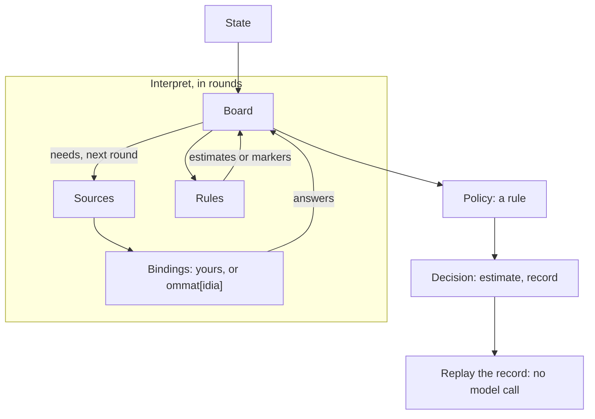

# ommat

Write each question and rule on its own. ommat composes them into the decision.

A workflow's decision is rarely one question. Ask about this; the answer decides whether you ask about that; once that is known, a rule can settle something else. Each piece is simple. The web of them is not, and the web is what you end up holding in your head and in the order of your code.

With ommat you write only the pieces, each declaring what it reads, and ommat works out the order:

- **A source** asks a model closed questions, yes or no, which label, a score or a value read from a text, each answer with probabilities, or with a confidence where the model gives one. A `when` asks it only if earlier answers call for it.
- **A rule** reads answers and settles an estimate, or returns a marker such as `Unsure`, never a `None` standing in for no answer. It is a function, or a decision table of rows over its inputs.
- **The policy** is the rule the design names as its own. Its estimate is the decision: a value, or a marker when the turn is undecided.
- **ommat** builds the dependency graph from those declarations and runs it in rounds, and `load` checks the whole design before any turn: every read has a provider, nothing depends on itself, and the types agree. Get each piece right and `load` makes sure the pieces fit, whether you have a dozen questions or a few hundred.
- **Each decision** comes with a record that replays the turn with no model call, and an undecided one with the root cause that says where to send it.

[idia](https://github.com/CRSiegfried/idia) puts the questions to the models; ommat decides.

## How a turn runs



ommat's one operation is **decide**, which runs interpret. Interpret: sources fetch model answers and other outside values onto a shared board, a blackboard, in rounds, through bindings the caller supplies; rules, which are functions or tables with declared reads, turn them into estimates. An unknown stays unknown, as a marker (`Unsure`, `Unavailable` or `Unasked`), never a quiet no or a `None`. The policy is one of the rules; its estimate is the decision.

Decide returns a `Decision`: `.estimate`, the policy's estimate, `.record`, the record of the turn, and `.design_hash`. A source's binding is your code and may call any tool, one that writes included; the record holds what it returned, and later sources and rules read it. When the estimate is a marker the turn is undecided, and `escalation(record)` gives the marker's kind and cause, the root cause it traces to, and the record hash, to route it. To hand a turn on to a generative model, render the record with `ommat.conversation`: every source call of the turn, your tools' reads and writes included, and its decision or why it is undecided, as minimal tool calls and their results. Nothing after decide consults the model.

## A first decision

This runs as it is, with no API keys: a fixed binding answers in place of a model. The design asks one choice question, turns its answer into a topic with one rule, and decides the route with a policy rule:

<!-- demo -->
```python
from ommat import Design, Question, ReadView, Rule, Source, Text
from ommat import Undetermined, decide_sync, escalation, load, replay_sync
from ommat import types as t
from ommat.bindings import fixed
from ommat.helpers import pick_with_margin

topics = ["billing", "shipping", "other"]
ask = Question("choice", Text("What is the message about?"), topics)


def topic(r: ReadView) -> str | Undetermined:
    return pick_with_margin(r, "q:topic", 0.6, 0.2)


def route(r: ReadView) -> str | Undetermined:
    value = r.read("d:topic")
    if isinstance(value, Undetermined):
        return value
    return f"open_{value}_ticket"


DESIGN = Design(
    name="helpdesk",
    state=t.record(message=t.string),
    sources={"triage": Source({"q:topic": ask}, needs=["t:state"])},
    rules={
        "topic": Rule("d:topic", t.label(*topics), topic, version="1", reads=["q:topic"]),
        "route": Rule("d:route", t.string, route, version="1", reads=["d:topic"]),
    },
    policy="d:route",
)
```

The demo keeps everything in one script; in a real project keep the design in a module (see the tutorial [Write a design](docs/tutorials/write-a-design.md)).

A binding answers a source's questions. `fixed` answers each ref it is asked from a mapping, here the probability of each topic, and stands in for a model in a test. With `ommat[idia]` installed, `ommat.bindings.idia.oracle_binding` builds a binding over a real provider: it receives a call's sources together and sends those that share a state and options to the provider as one request, split only where the provider's limits require; a source the provider's preflight refuses with the others, or whose state differs, goes on its own. A binding of your own is a plain async function, as [Add a source](docs/how-to/add-a-source.md) shows; its [Path C](docs/how-to/add-a-source.md#path-c-write-a-binding-over-a-chat-endpoint) answers `noul` and `choice` questions with probabilities over a chat endpoint, importing only `ommat` and `ommat.bindings`:

```python
classifier = fixed({"q:topic": {"billing": 0.8, "shipping": 0.1, "other": 0.1}})
```

Decide, print the decision, then replay the turn from its record:

```python
loaded = load(DESIGN)
message = {"message": "The invoice is overdue and I want a refund."}
decision = decide_sync(loaded, message, {"default": classifier})
print(decision.estimate)
print("escalation:", escalation(decision.record))
rerun, findings = replay_sync(decision.record, loaded)
print("replay findings:", findings)
```

It prints:

```text
open_billing_ticket
escalation: None
replay findings: []
```
<!-- /demo -->

`billing` is at 0.8, at or above the bar of 0.6 and 0.7 ahead of the next label, so the topic rule picks it and the policy decides `open_billing_ticket`. Had `billing` been under 0.6, or less than 0.2 ahead, the topic rule would have returned `Unsure`, the policy would have passed it on, and the turn would be undecided: `decision.estimate` would be that marker and `escalation(decision.record)` would say why. Here the caller opens the ticket. Replay reruns the turn from the record, under the same loaded design, with no model call, and finds no difference.

**The name.** Ommat and Idia come from *ommatidia*, the thousands of small hexagonal eyes that make up a compound eye and combine into one picture: *ommat-* is the Greek stem for "eye", *-idia* "little ones". Many small, cheap questions add up to one full picture. Ommat is the engine that asks them; Idia puts them to the models.

```text
                .--.       .--.
            _.-'    `-.__.-'    `-._
          .'      (o)     (o)        `.
         /   (o)                  (o) \
        /              .------.        \
       |     (o)      /        \   (o)  |
       |              |   @    |        |
       |  (o)         \        /   (o)  |
        \       (o)    `------'        /
         \                   (o)      /
          `-.    _       _         .-'
             `--' `-----' `-------'
```

## Install

ommat is installed from its git tag until it is on a package index:

```sh
pip install "ommat @ git+https://github.com/CRSiegfried/ommat@v0.4.0"
```

The core imports only the Python standard library. `ommat[idia]` is the binding ommat ships to decision-model providers, through the [idia](https://github.com/CRSiegfried/idia) library; install idia from its tag first, with the extras for the providers you use, as the [tutorial](docs/tutorials/decide-with-idia.md) shows, since pip ignores ommat's `[tool.uv.sources]` and `pip install "ommat[idia] @ git+…"` alone cannot find idia, which is on no package index yet:

```sh
pip install "idia[openai,cloudflare] @ git+https://github.com/CRSiegfried/idia@v0.1.0"
pip install "ommat[idia] @ git+https://github.com/CRSiegfried/ommat@v0.4.0"
```

`ommat.bindings.idia` and its `oracle_binding` follow idia while idia is 0.x: they may change in any minor release when idia changes, and the changelog will say so.

`ommat[pydantic-ai]` adds the Pydantic AI renderer, `ommat.conversation.pydantic_ai`, outside the compatibility promise like the rest of `ommat.conversation`:

```sh
pip install "ommat[pydantic-ai] @ git+https://github.com/CRSiegfried/ommat@v0.4.0"
```

To look at stored records, write them to `.json` files as `decision.record.document`, with the design's `loaded.document` beside them, and run `python -m ommat.lens <file or folder> --open`. The page opens on what the turn did, in plain words: the decision, each decision table's rows, and each source asked or not and why. It gives an overview of the design; explores it a slice at a time around one node, with a turn's entries marked on it; lists its targets and its decision tables' rows; and draws the whole dependency graph by round, each turn over it with every entry marked against the bounds its design declares and the lineage from the decision to its root, and the turns as a table. A design file alone is enough to see the design. It holds the records whole, so keep it as you keep them. `ommat.lens` is outside the compatibility promise too. For the same files as text, one node, call or entry per line, or as JSON, run `python -m ommat.outline <file or folder>`.

## Where next

- [Write your first design](docs/tutorials/write-a-design.md), the tutorial to start with.
- [Decide with real models through idia](docs/tutorials/decide-with-idia.md), which binds a design to model providers.
- [Add a source](docs/how-to/add-a-source.md), which answers a new oracle through idia or a binding of your own.
- [Gate a source on an earlier estimate](docs/how-to/gate-a-source.md), which asks a later question only when an estimate holds a value, without sending the estimate to the model.
- [Hand off a turn](docs/how-to/hand-off-a-turn.md), which gives the next model in a conversation the turn's calls and decision as Chat Completions or Pydantic AI messages, with the words you choose.
- [Combine small designs into one](docs/how-to/combine-designs.md), which rolls a workflow selector and its workflows up into one design, so their questions go to the model in one call.
- [Read a record](docs/how-to/read-a-record.md), which reads an entry, the call that answered it, why a turn is undecided, a rule that failed on a decided turn, and the answers across turns.
- [Lay out a design module so it reads](docs/how-to/lay-out-a-design.md), which orders a design's module, names its rules, tables and bars, and checks its docstring map and a tidy in its tests.
- [The spec](docs/spec/README.md), what ommat does and leaves out.
- [CHANGELOG.md](CHANGELOG.md), each release.
- [idia](https://github.com/CRSiegfried/idia), the library that puts the questions to the models.

## Using with an AI coding agent

[skills/ommat](skills/ommat/SKILL.md) is an agent skill: it tells a coding agent when to use ommat, the core pattern and the pitfalls, and links into these docs for the rest. Copy it from a clone at v0.4.0 into your agent's skills folder, for Claude Code:

```sh
cp -r skills/ommat ~/.claude/skills/
```

To use ommat with idia, add idia's own skill too, from its [skills/idia](https://github.com/CRSiegfried/idia/tree/v0.1.0/skills/idia).

## Status

Pre-release, at 0.4.0. On `main` it writes format-10 records and format-11 design documents. It reads record formats 1 to 10, replays formats 8 to 10 (a format-8 record replayed under a loaded format-11 design reports `design-mismatch` and `helpers-mismatch`), and loads only design format 11; a design of an earlier format is refused, naming its format.

0.4.0 refuses decision tables and data rules at load; the next release, unreleased on `main`, runs them. 0.4.0 asks a `choice` over a candidate set of strings, and a question once per candidate of one, but leaves out candidate sets of records and grounded rules, tables and `t:` sources, which `main` runs. `load` refuses the forms the [spec](docs/spec/README.md) lists beside what it covers. No state carries from one turn to the next: each turn stands alone, and the caller gives a second turn what it needs, the prior turn's record hash included, in its input state.

## Contributing

Issues first: see [CONTRIBUTING.md](CONTRIBUTING.md). Report vulnerabilities privately, as described in [SECURITY.md](SECURITY.md). This project follows the [Contributor Covenant](CODE_OF_CONDUCT.md).

## License

MIT. See [LICENSE](LICENSE).
