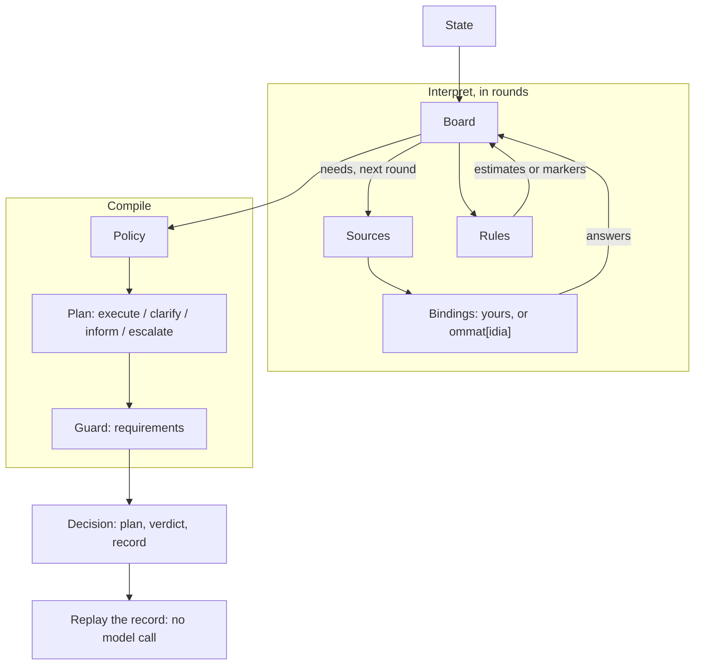

# ommat

Turn many small model answers into one checked, replayable plan.

Ask an LLM to make a workflow's decision directly and you get a choice with no probability, nothing checked before a tool runs, and no way to show later why it chose.

ommat splits the decision. A model answers many small closed questions, such as yes or no, which of these labels, or a value read from a text, each with probabilities, or with a confidence where the model gives one; your own rules and policy, written as Python functions, turn the answers into a plan; a guard checks the plan before any tool runs; and each decision comes with a record that replays the turn with no model call. [idia](https://github.com/CRSiegfried/idia) puts the questions to the models; ommat decides.

## How a turn runs



ommat's one operation is **decide**, which runs two stages:

- **Interpret.** Sources fetch model answers and other outside values onto a shared board, a blackboard, in rounds, through bindings the caller supplies; rules, which are functions with declared reads, turn them into estimates. An unknown stays unknown, as a marker (`Unsure`, `Unavailable` or `Unasked`), never a quiet no or a `None`.
- **Compile.** One policy reads the estimates and writes the plan: execute these steps, clarify, inform, or escalate. If the policy raises, reads what it did not declare, or returns a plan that breaks ommat's plan rules, compile puts a `broken` plan in its place that names the cause. The guard then checks an `execute` plan: every requirement the design declares for the plan and every requirement each step declares must hold, and a step that declares none refuses the plan unless the design turns that off. Every other plan passes.

Decide returns the plan, the guard's verdict and a record of the turn, and calls no tool. The caller runs the steps of a passed `execute` plan with its own workflow engine, or with the small reference runner ommat ships. Nothing after decide consults the model.

## A first decision

This runs as it is, with no API keys: a stand-in binding answers in place of a model. The design asks one choice question, turns its answer into a topic with one rule, and routes on the topic with a policy:

<!-- demo -->
```python
from ommat import CallResult, Design, Origin, Plan, Policy, Question, ReadView
from ommat import Requirement, Rule, Source, SourceCall, Step, Text, Undetermined
from ommat import decide_sync, load, replay_sync
from ommat import types as t
from ommat.helpers import pick_with_margin

topics = ["billing", "shipping", "other"]
ask = Question("choice", Text("What is the message about?"), topics)


def topic(r: ReadView) -> str | Undetermined:
    return pick_with_margin(r, "q:topic", 0.6, 0.2)


def route(r: ReadView) -> Plan:
    value = r.read("d:topic")
    if isinstance(value, Undetermined):
        return Plan("clarify", reply="Is this about billing or shipping?")
    needs = [Requirement("d:topic", value)]
    return Plan("execute", [Step("open_ticket", {"queue": Origin(ref="d:topic")}, needs)])


DESIGN = Design(
    name="helpdesk",
    state=t.record(message=t.string),
    sources={"triage": Source({"q:topic": ask}, needs=["t:state"])},
    rules={"topic": Rule("d:topic", t.label(*topics), topic, version="1", reads=["q:topic"])},
    policy=Policy(route, version="1", reads=["d:topic"]),
    tools=["open_ticket"],
)
```

The demo keeps everything in one script; in a real project keep the design in a module (see the tutorial [Write a design](docs/tutorials/write-a-design.md)).

The binding is a plain async function. With `ommat[idia]` installed, `ommat.bindings.idia.oracle_binding` builds one over a real provider. A binding receives each source's questions together, and `ommat[idia]` sends them to the provider as one request, split only where the provider's limits require:

```python
async def classifier(batch: tuple[SourceCall, ...], *, seconds: float) -> CallResult:
    answer = {"billing": 0.8, "shipping": 0.1, "other": 0.1}
    return CallResult({ref: answer for call in batch for ref in call.questions})
```

Decide, print the plan and the verdict, then replay the turn from its record:

```python
loaded = load(DESIGN)
message = {"message": "The invoice is overdue and I want a refund."}
decision = decide_sync(loaded, message, {"default": classifier})
print(decision.plan.kind, decision.verdict.kind)
for step in decision.plan.steps:
    args = {k: v.ref for k, v in step.arguments.items()}
    print(step.tool, args, [(q.ref, q.value) for q in step.requirements])
rerun, findings = replay_sync(decision.record, loaded)
print("replay findings:", findings)
```

It prints:

```text
execute passed
open_ticket {'queue': 'd:topic'} [('d:topic', 'billing')]
replay findings: []
```
<!-- /demo -->

`billing` is at 0.8, at or above the bar of 0.6 and 0.7 ahead of the next label, so the rule picks it. Had `billing` been under 0.6, or less than 0.2 ahead, the rule would have returned `Unsure` and the policy would ask to clarify. The step's `queue` argument names `d:topic` rather than copying its value; whoever runs the step reads the value from the record. The step requires `d:topic` to be `billing`, the board holds `billing`, so the guard passes the plan. Replay reruns the turn from the record, under the same loaded design, with no model call, and finds no difference.

**The name.** Ommat and Idia come from *ommatidia*, the thousands of small hexagonal eyes that make up a compound eye and combine into one picture: *ommat-* is the Greek stem for "eye", *-idia* "little ones". Many small, cheap questions add up to one full picture. Ommat is the engine that asks them; Idia puts them to the models.

```text
                .--.       .--.
            _.-'    `-.__.-'    `-._
          .'      (o)     (o)        `.
         /   (o)                  (o) \
        /              .------.        \
       |     (o)      /        \   (o)  |
       |              |   @    |        |
       |  (o)         \        /   (o)  |
        \       (o)    `------'        /
         \                   (o)      /
          `-.    _       _         .-'
             `--' `-----' `-------'
```

## Install

ommat is installed from its git tag until it is on a package index:

```sh
pip install "ommat @ git+https://github.com/CRSiegfried/ommat@v0.4.0"
```

The core imports only the Python standard library ([ADR-0001](docs/adr/0001-write-the-core-in-python-with-no-runtime-dependencies.md)). `ommat[idia]` is the binding ommat ships to decision-model providers, through the [idia](https://github.com/CRSiegfried/idia) library; install idia from its tag first, with the extras for the providers you use, as the [tutorial](docs/tutorials/decide-with-idia.md) shows:

```sh
pip install "idia[openai,cloudflare] @ git+https://github.com/CRSiegfried/idia@v0.1.0"
pip install "ommat[idia] @ git+https://github.com/CRSiegfried/ommat@v0.4.0"
```

`ommat.bindings.idia` and its `oracle_binding` follow idia while idia is 0.x: they may change in any minor release when idia changes, and the changelog will say so.

## Where next

- [Write your first design](docs/tutorials/write-a-design.md), the tutorial to start with.
- [Decide with real models through idia](docs/tutorials/decide-with-idia.md), which binds a design to model providers.
- [The spec](docs/spec/README.md), what ommat does and leaves out.
- [CHANGELOG.md](CHANGELOG.md), each release.
- [idia](https://github.com/CRSiegfried/idia), the library that puts the questions to the models.

## Using with an AI coding agent

[skills/ommat](skills/ommat/SKILL.md) is an agent skill: it tells a coding agent when to use ommat, the core pattern and the pitfalls, and links into these docs for the rest. Copy it from a clone at v0.4.0 into your agent's skills folder, for Claude Code:

```sh
cp -r skills/ommat ~/.claude/skills/
```

To use ommat with idia, add idia's own skill too, from its [skills/idia](https://github.com/CRSiegfried/idia/tree/v0.1.0/skills/idia).

## Status

Pre-release, at 0.4.0. It writes format-4 records and design documents and reads formats 1 to 4, so the records and designs of earlier releases still load and replay, given each design's stored document and the functions it names.

0.4.0 asks a `choice` over a candidate set of strings, but leaves out decision tables, data rules, plan declarations, candidate sets of records and per-candidate questions, which `load` refuses in a design, among other things the [spec](docs/spec/README.md) lists beside what it covers. No state carries from one turn to the next: each turn stands alone, and the caller gives a second turn what it needs, the prior turn's record hash included, in its input state.

## Contributing

Issues first: see [CONTRIBUTING.md](CONTRIBUTING.md). Report vulnerabilities privately, as described in [SECURITY.md](SECURITY.md). This project follows the [Contributor Covenant](CODE_OF_CONDUCT.md).

## License

MIT. See [LICENSE](LICENSE).
